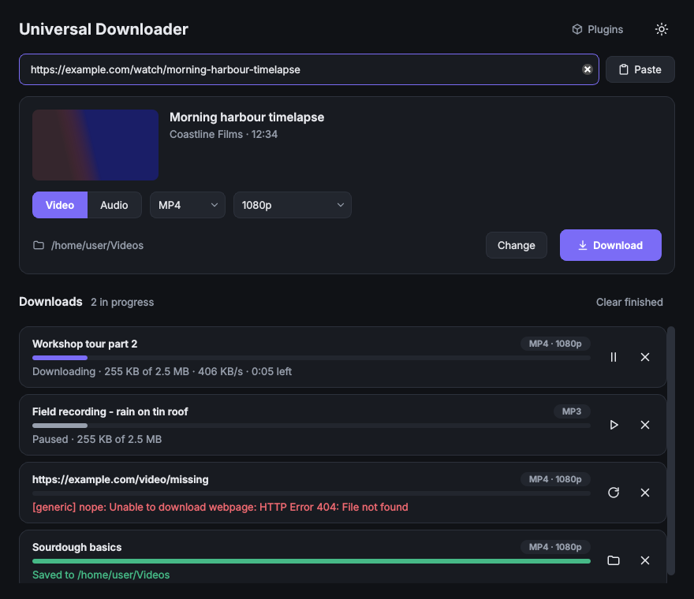

# Universal Downloader

[](https://github.com/QuantumBoy-729/YT-videoDownloader/actions/workflows/ci.yml)

A desktop app for saving videos and audio from YouTube and the
[many other sites](https://github.com/yt-dlp/yt-dlp/blob/master/supportedsites.md)
supported by [yt-dlp](https://github.com/yt-dlp/yt-dlp). Paste a link, pick a
quality, press Download.



*Example data; the app also has a light theme ([screenshot](docs/screenshot-light.png)).*

## Features

- **Real quality selection** - paste a link and pick from the resolutions that
  video actually has, up to 4K. Video and audio streams are downloaded
  separately and merged, so 720p, 1080p and 4K work (not just the 360p combined file).
- **Video or audio** - MP4, MKV or WebM video; MP3, M4A or Opus audio.
- **Download queue** - queue as many links as you like; two run at a time, each
  with its own progress, speed and time remaining.
- **Pause, resume, cancel, retry** - per download. Cancelling removes the
  partial file.
- **Playlists** - download a whole playlist, or just the one video from a
  playlist link.
- **Plugins** - add site support and processing steps from a built-in list, from
  GitHub, or from a zip file (see [Plugins](#plugins)).
- **Light and dark themes**, drag-and-drop links, and your folder, format and
  quality choices remembered between runs.
- **No ffmpeg setup** - an ffmpeg binary comes with the app. A system ffmpeg on
  `PATH` is used instead if you have one.

## Install

### Windows: download the program

Download `UniversalDownloader.exe` from the
[latest release](https://github.com/QuantumBoy-729/YT-videoDownloader/releases/latest)
and run it. Nothing to install, and no Python needed.

The program is not code-signed, so Windows SmartScreen may say "Windows protected
your PC". Choose **More info**, then **Run anyway**. If you would rather not,
install with pip below, or build the program yourself from the source.

### Any system: install with pip

Needs Python 3.10 or newer (tested on 3.10 to 3.13). [pipx](https://pipx.pypa.io)
keeps the app in its own environment:

```bash
pipx install universal-downloader
```

or with plain pip:

```bash
pip install universal-downloader
```

Then start it:

```bash
universal-downloader
```

If that command is not found, `python -m universal_downloader` does the same.

### From source

```bash
git clone https://github.com/QuantumBoy-729/YT-videoDownloader.git
cd YT-videoDownloader
pip install .
universal-downloader
```

To check that an installation is healthy (finds ffmpeg, loads plugins, opens a
window), run `universal-downloader --smoke-test`; it prints a short report and
exits 0 if everything works.

## Using it

1. Paste a link (or press **Paste**, or drop a link on the window). The title,
   thumbnail and available qualities appear.
2. Choose **Video** or **Audio**, the format, and the quality.
3. Press **Download**. Add more links while it works.

Each download shows its progress and has buttons to pause, cancel, retry, or
open its folder. Change where files are saved with **Change**.

## What it can't do

The app downloads what yt-dlp can, which is roughly 1,800 sites plus a generic
fallback for pages with a plain video file. It cannot:

- **Download DRM-protected video** (Netflix, Disney+, Prime Video and similar).
- **Download anything that needs you to sign in** - private, members-only, paid or
  age-confirmed videos. There is no way to give it your account or browser cookies.
- **Get around region locks.** There is no proxy setting.
- **Download subtitles, or cut out a time range.** Neither is offered.
- **Handle live streams reliably.** They have not been tested with the queue.

## When a download fails

- **Update yt-dlp.** Sites change constantly, and an old version is the usual
  cause. With a pip install, run `pip install -U yt-dlp`. The Windows program has
  the version from its build date, so download a newer release.
- **The message says support "looks out of date".** The site changed and
  yt-dlp has not caught up yet. Update, then wait for a yt-dlp release or look for
  a [plugin](#plugins) that adds the site.
- **Only low qualities are offered.** Some sites limit what they show without a login.

The app includes small stopgap fixes for sites that current yt-dlp releases
handle badly (see `universal_downloader/core/site_fixes.py`). They are removed
once yt-dlp fixes the site itself.

## Plugins

Open **Plugins** in the top-right corner to install or remove add-ons.

| Plugin | What it does | Source |
| --- | --- | --- |
| Upload date as file date | Sets each file's modified date to the video's upload date, so folders sort by release date. | [bradenhilton/yt-dlp-FixupMtime](https://github.com/bradenhilton/yt-dlp-FixupMtime) |
| DeArrow titles | Names YouTube downloads with the community-written [DeArrow](https://dearrow.ajay.app/) title when one exists. Contacts `sponsor.ajay.app` for each download. | [QuantumWarpCode/yt-dlp-dearrow](https://github.com/QuantumWarpCode/yt-dlp-dearrow) |

The list comes from [yt-dlp's own plugin page](https://github.com/yt-dlp/yt-dlp/wiki/Plugins),
limited to plugins that do something useful in this app, and each one is
pinned to an exact commit so what gets installed cannot change underneath you.
To add one, append a `CatalogEntry` to `CATALOG` in
`universal_downloader/core/plugins.py`.

### More plugins from GitHub

Under **More from GitHub**, press **Browse plugins on GitHub** to list
everything tagged [`yt-dlp-plugins`](https://github.com/topics/yt-dlp-plugins)
(around 80 repositories, most-starred first, archived ones left out). Each shows
its stars, last update and licence, with a link to the source; there is a filter
box, and **Install** asks for confirmation first. The list is fetched live, so it
needs an internet connection and is subject to GitHub's request limit for
anonymous use (about 10 searches a minute).

Nothing on that list has been reviewed. It includes plugins for other tools,
plugins that need extra programs, and at least one collection of rejected or
controversial code, so read the description and source before installing.

You can also paste a repository page (`https://github.com/owner/repo`, or a
`/tree/<branch>` link) or any zip archive into **Install from a zip file or
link**. Each install records the exact version it fetched.

What to expect once installed:

- **Plugins that add site support or YouTube features** work as soon as they are
  installed.
- **Post-processing plugins** (steps that run on each download, such as setting
  file dates, fixing titles or applying ReplayGain) get controls in the list:
  a checkbox to use the step, a choice of when it runs, and an options box
  (`name=value; name=value`, the same way yt-dlp's command line takes them; see
  the plugin's page for what it accepts). Steps on the built-in list start
  switched on; steps from anywhere else start off until you turn them on. Your
  choices are remembered and apply to downloads you start afterwards. If a step
  cannot be loaded or rejects its options, the download fails with a message
  naming the step instead of silently skipping it.
- **Plugins that need extra Python packages or programs** may not load, since the
  app cannot install packages for them.

Good to know:

- **Plugins are third-party code** and run with the same access to your computer
  as the app. Install only ones you trust.
- Only the plugin's `yt_dlp_plugins` folder is unpacked - its `setup.py` is
  never run and extra Python packages it may depend on are not installed.
- Plugins are kept in a per-user folder (`%APPDATA%\UniversalDownloader\plugins` on
  Windows, `~/.local/share/universal-downloader/plugins` on Linux,
  `~/Library/Application Support/UniversalDownloader/plugins` on macOS), so they work
  in the Windows program too and survive app updates.

## Building the Windows program yourself

```bash
pip install ".[build]"
python packaging/build.py
```

The result is written to `dist/`. The same script produces a native program on
Linux and macOS, but only the Windows build is published.

## Development

```bash
pip install -e ".[dev]"
pytest
```

The tests need ffmpeg (or the one bundled by `imageio-ffmpeg`) but no internet:
they serve generated clips from a local HTTP server and drive both the download
engine and the real window (offscreen).

```
universal_downloader/
  core/      download engine - no GUI imports, usable on its own
    options.py     DownloadRequest -> yt-dlp options (format selection)
    engine.py      DownloadJob (pause/resume/cancel), fetch_info, find_ffmpeg
    plugins.py     plugin catalog, installer, processing-step settings
    discovery.py   lists plugins from the yt-dlp-plugins GitHub topic
    site_fixes.py  stopgap fixes for sites broken in current yt-dlp
  ui/        Qt interface
    main_window.py, queue_item.py, plugins_dialog.py, theme.py, ...
  selfcheck.py   the --smoke-test report
packaging/   PyInstaller build script
tests/
```

Using the engine without the GUI:

```python
from pathlib import Path
from universal_downloader.core import DownloadJob, DownloadRequest

job = DownloadJob(
    DownloadRequest(url="https://...", output_dir=Path("videos"), max_height=1080),
    on_progress=lambda p: print(p.stage, p.fraction),
)
result = job.run()  # blocks; job.pause() / resume() / cancel() from another thread
print(result.state, result.files, result.error)
```

Releases are described in [RELEASING.md](RELEASING.md) and changes in
[CHANGELOG.md](CHANGELOG.md).

## Legal

For personal use. Only download content you have the right to download, and
respect the terms of service of the sites you use. This project is not
affiliated with YouTube, Google or the yt-dlp project.

## License

[The Unlicense](LICENSE) - public domain.
